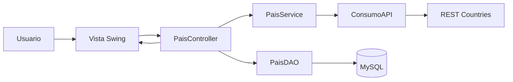

# Plan de implementación del taller de países GR09

**Estado:** análisis y planificación. La aplicación todavía no está implementada. Estudio realizado el 16 de noviembre de 2026.

**Objetivo:** construir primero una aplicación desktop Java con interfaz atractiva que consulte REST Countries, persista países en MySQL, gestione un CRUD y presente búsquedas y estadísticas mediante MVC.

**Fuente:** [documento original del taller](../requisitos/Taller%20Práctico%20Consumo%20de%20APIs%20Públicas%20en%20Java%20con%20MySQL%20aplicando%20el%20Patrón%20MVC.docx), secciones 1 a 15. Las decisiones adicionales de este plan son propuestas técnicas; no se atribuyen al docente.

**Decisiones del usuario:** desktop primero; organización de carpetas adaptada de la plantilla TI.1.1; AWS como plataforma cloud; workspace `.sws` en la raíz, configurado después. [AGENTS.md](../AGENTS.md) contiene el árbol y las reglas persistentes.

Las rutas de implementación indicadas abajo son relativas a la raíz `U2/T1/TI.2.1. PAO202651_CONSUMO_API_PUB_NRC36884_GR09`, salvo que se indique lo contrario. Ejecutar las etapas en orden y marcar las casillas solo después de comprobar sus resultados.

## 1 Qué exige realmente el documento

| Requisito | Referencia | Evidencia de aceptación | Paso |
| --- | --- | --- | --- |
| Java, Maven, NetBeans y MySQL | 1, 4 y 5 | Compilación y conexión verificadas | 1–3 |
| MVC con modelo, DAO, controlador y vista | 3, 6–12 | Responsabilidades separadas en el código | 4–8 |
| Consumir API y convertir JSON | 2, 8 y 10 | Países válidos obtenidos de una respuesta real | 5–6 |
| Guardar nombre, capital, región, población y moneda | 2, 5 y 7 | Cinco campos completos en MySQL, salvo datos ausentes en origen | 3–7 |
| Importar desde un botón | 11 y 13 | Resultado real de importación y tabla actualizada | 8–9 |
| Consultar país por nombre | Actividad 1 | Consulta externa por nombre y resultados identificados | 10 |
| Crear, leer, actualizar y eliminar | Actividad 2 | Ciclo CRUD persistente y validado | 11 |
| Mostrar países en JTable | Actividad 3 | Tabla con datos de MySQL | 8 |
| Buscar por región | Actividad 4 | Filtro que conserva los valores del proveedor | 10 |
| Países por región, país más poblado y región con más países | Actividad 5 | Tres resultados calculados desde la base local | 12 |
| Análisis de arquitectura y evolución | 15 | Respuestas propias vinculadas al código y sus límites | 14 |

El documento usa `JFrame` y `JTable`: la primera entrega es **Swing**, confirmada por el usuario. No exige implementar web, móvil y consola. Las carpetas de esos clientes se conservan como parte de la plantilla organizativa.

## 2 Hallazgos que cambian la forma de codificar

### La API del ejemplo fue retirada

Se probaron por HTTP los endpoints originales `/v3.1/all`, `/v3.1/all?fields=...` y `/v3.1/name/ecuador?fullText=true&fields=...`. Los tres respondieron HTTP 200, pero el cuerpo era un objeto de error con `success=false` y `data=null`, sin lista de países. Agregar `fields` no corrigió el problema. El proveedor publicó el [retiro de las versiones anteriores y la migración a v5](https://restcountries.com/docs/countries/legacy-api-deprecation).

**Consecuencia:** no copiar literalmente `JsonParser.parseString(json).getAsJsonArray()`. Primero comprobar HTTP, errores y estructura del JSON. Una respuesta 200 también puede ser un fallo funcional.

La [documentación vigente](https://restcountries.com/docs/countries) indica la base `https://api.restcountries.com/countries/v5`, autenticación Bearer, registros en `data.objects` y paginación con `limit` y `offset`. Listar y buscar por nombre requieren nuevas URLs y mapeo. Registrar esta adaptación como corrección de compatibilidad del enunciado.

Se verificó además la clave pública demo: al consultar Ecuador devolvió una muestra de Canadá con `data._demo`. Sirve para estudiar la estructura; **no acredita búsqueda real, catálogo completo ni importación completa**. Antes de la integración real hará falta una clave válida del usuario, configurada externamente. No crear cuentas ni contratar servicios como parte de este plan.

### El proyecto actual todavía es una plantilla web

`T1_consumo_api_pub_gr09/pom.xml` empaqueta un WAR y declara Jakarta EE `11.0.0-M1`. Solo existen un endpoint de ping, configuración Jakarta y un `index.html` con Hello World. No hay modelo País, DAO, conexión MySQL, controlador de negocio ni interfaz de países.

Se consideran dos caminos: convertir ese WAR a desktop o conservarlo y crear un proyecto desktop en la ubicación de la plantilla. Se propone el segundo para respetar la estructura solicitada y preservar el antecedente existente. No hay lógica de negocio implementada que trasladar.

El desktop será un proyecto Maven **JAR** independiente en `04. CLIESC/T1_consumo_api_pub_gr09_desktop`. No necesita Jakarta EE ni servidor de aplicaciones. Su compatibilidad no depende del servidor configurado en el WAR.

### Los ejemplos son una base didáctica incompleta

| Hallazgo en el enunciado | Corrección que debe cubrir la implementación |
| --- | --- |
| Controlador guarda capital y moneda como cadenas vacías | Mapear realmente esos campos, incluso listas de varios valores |
| Conexión con contraseña fija y retorno `null` | Configuración externa y `SQLException` propagada |
| HTTP sin tiempos límite y errores solo por consola | Tiempos límite, validación del cuerpo y mensaje útil |
| DAO no cierra todos los recursos | `try-with-resources` en conexión, sentencia y resultados |
| Mensaje de éxito aunque falle el guardado | Confirmar únicamente después del commit |
| Inserción por país sin controlar duplicados | Identidad estable y segunda importación sin duplicados |
| Operación de red dentro del evento del botón | Trabajo en segundo plano con `SwingWorker` |
| `initComponents()` sin implementación y getters/setters omitidos | Crear los componentes y métodos reales en NetBeans |
| Sección teórica mezcla C#, Entity Framework, SQL Server y Azure | Explicar el concepto usando Java, JDBC, MySQL y AWS |
| MVC se contrasta con monolito como si fueran excluyentes | La aplicación será un monolito organizado con MVC; los conceptos operan en niveles distintos |

Spring Boot, microservicios, Redis, JWT, circuit breaker, Docker y Kubernetes aparecen como evolución y discusión. No son dependencias obligatorias del CRUD desktop. Las ventajas de rendimiento o disponibilidad que menciona la teoría no son garantías automáticas.

## 3 Organización del trabajo y arquitectura

Crear ahora las carpetas documentales y las reservas de clientes indicadas en `AGENTS.md`. Crear el proyecto y sus fuentes cuando comience la codificación. Los nombres de clases y paquetes de Celulares no se copian.

Dentro del nuevo proyecto Maven, conservar como base el paquete `com.mycompany.t1_consumo_api_pub_gr09` y esta distribución propuesta:

```text
src/main/java/com/mycompany/t1_consumo_api_pub_gr09/
├── Main.java
├── modelo/
│   ├── Pais.java
│   ├── Conexion.java
│   ├── ConsumoAPI.java
│   ├── PaisDAO.java
│   ├── ResultadoImportacion.java
│   └── EstadisticasPaises.java
├── servicio/
│   └── PaisService.java
├── controlador/
│   └── PaisController.java
└── vista/
    ├── FrmPais.java
    ├── DlgPais.java
    └── PanelReportes.java
src/main/resources/imagenes/
src/test/java/com/mycompany/t1_consumo_api_pub_gr09/
src/test/resources/api/
```

`PaisService` será una interfaz pequeña para la fuente externa: `List<Pais> obtenerTodos()` y `List<Pais> buscarPorNombre(String nombre)`, con errores de comunicación propagados. `ConsumoAPI` la implementa. El controlador recibe la interfaz y el DAO por constructor; `Main` conecta las implementaciones. Esto permite explicar DIP y probar la importación con una fuente simulada, sin una infraestructura adicional de inyección.



La vista captura datos y muestra resultados; no contiene SQL, claves ni llamadas HTTP. El cliente API interpreta el contrato externo. El DAO conoce JDBC. El controlador valida y coordina los casos de uso. Las lecturas ordinarias y reportes consultan MySQL; la API solo se utiliza al importar o al solicitar una búsqueda externa.

## 4 Propuesta visual del desktop


La imagen es una propuesta editable con datos ilustrativos. No es una captura de software funcionando ni del volumen real de países.

**Dirección visual propuesta:** un explorador de países llamado “Atlas GR09”, fondo marfil `#F5F6F2`, superficies blancas, texto oscuro `#172D2B`, verde petróleo `#12665B` para acciones principales y bordes suaves `#DCE5DF`. Tipografía Segoe UI, texto de 14–16 px, títulos de 26–30 px, separación de 8/16/24 px, controles de al menos 36 px de alto y filas de aproximadamente 44 px. Son referencias visuales que se adaptarán a la escala de Windows.

Usar Swing con Nimbus y componentes nativos bien compuestos. Probar `BorderLayout`, `GridBagLayout`, `JScrollPane` y `JSplitPane`; evitar posiciones absolutas que se rompan al redimensionar. No agregar un framework de interfaz para conseguir espaciado y colores.

| Pantalla o estado | Contenido y comportamiento |
| --- | --- |
| Explorar países | Cabecera con ilustración de globo, búsqueda local, selector de región, JTable y ficha del país seleccionado |
| Ficha | Bandera, nombre, capital, región, población y monedas; valores ausentes identificados |
| Crear o editar | Un mismo diálogo `DlgPais`, etiquetas claras, campos precargados al editar y errores junto al campo |
| Reportes | Recuentos por región en barras, país o países más poblados y región o regiones con mayor número de registros |
| Carga | Mensaje de operación y progreso indeterminado mientras se descarga; desactivar acciones incompatibles |
| Base vacía | “Todavía no hay países guardados” y acceso a “Importar países” o “Nuevo país” |
| Consulta vacía | “No encontramos países con estos filtros” y acción “Limpiar filtros” |
| API no disponible | Conservar la tabla local y mostrar “No se pudo consultar la API. Tus datos guardados siguen disponibles” |
| Base no disponible | Informar el problema de conexión y permitir reintentar; no presentar la tabla vacía como una consulta correcta |

**Imágenes:** preparar una ilustración local de globo para la cabecera y un marcador local para banderas no disponibles. Las banderas reales se toman del campo de imagen validado del proveedor, se descargan fuera del hilo de interfaz y se reutilizan en memoria. Elegir PNG compatible con `ImageIO`; no depender de emojis o de soporte SVG nativo de Swing. Conservar proporción y un tamaño estable. Un fallo de imagen no impide consultar o guardar países.

Mantener texto legible sobre fondos sólidos, foco visible, navegación con Tab, etiquetas asociadas a los campos y botones con texto. Eliminar requiere confirmación con el nombre del país. Los reportes incluyen cifras y etiquetas, no solo colores. Verificar la distribución en 1280×720 y con escalado de Windows al 125 %.

## 5 Paso a paso para codificar después

### Paso 1 Preparar el proyecto desktop

- [ ] Abrir la raíz del taller en NetBeans y crear Java Application con Maven en `04. CLIESC/T1_consumo_api_pub_gr09_desktop`.
- [ ] Configurar JDK 17 o superior, codificación UTF-8 y empaquetado JAR. Declarar la clase principal `com.mycompany.t1_consumo_api_pub_gr09.Main`.
- [ ] Agregar Gson y MySQL Connector/J. El documento usa Gson `2.10.1` y Connector/J `8.3.0`: son sus versiones de referencia, no una afirmación de que sean las últimas. Verificar compatibilidad antes de fijar versiones.
- [ ] Preparar JUnit en alcance de pruebas para lógica no trivial; usar Maven de NetBeans si `mvn` no está en PATH. Mantener `target/` ignorado.
- [ ] Crear `Main` con arranque en `SwingUtilities.invokeLater` y un JFrame inicial sin lógica HTTP/JDBC.

**Comprobación:** Clean and Build termina correctamente y Run Project abre una ventana desktop. No se despliega un WAR para esta entrega.

### Paso 2 Definir configuración y verificar el acceso externo

- [ ] Leer `DB_URL`, `DB_USER`, `DB_PASSWORD` y `REST_COUNTRIES_API_KEY` desde el entorno o una configuración local ignorada. Documentar los nombres, sin valores secretos.
- [ ] Preparar una petición GET al endpoint vigente con `Authorization: Bearer ...`; verificar que no sea una respuesta demo.
- [ ] Guardar como fixture una respuesta reducida y sin secretos, con procedencia y fecha. Separarla de fixtures inventados para pruebas.
- [ ] Confirmar las rutas reales de los cinco datos requeridos antes de implementar el mapeo definitivo.

**Comprobación:** la respuesta real corresponde al país consultado. Si todavía no hay clave, se puede avanzar con fixtures y MySQL, registrando que la integración real sigue pendiente.

### Paso 3 Diseñar el modelo de datos y crear MySQL

**Archivos futuros:** modelos en `02. MER`; script `03. BDD/01_crear_api_paises.sql`; prueba de conexión en el proyecto desktop.

- [ ] Representar la entidad País en los modelos conceptual, lógico y físico; configurar PowerDesigner más adelante conforme a `AGENTS.md`.
- [ ] Mantener `api_paises` y tabla `pais` del enunciado con `id INT AUTO_INCREMENT`, `nombre`, `capital`, `region`, `poblacion BIGINT` y `moneda`.
- [ ] Proponer `codigo_iso CHAR(3) NOT NULL UNIQUE` como identidad estable para evitar duplicados; `bandera_url` opcional para el recurso visual. Explicar que son mejoras de implementación.
- [ ] Usar `utf8mb4`, población no negativa y campos obligatorios coherentes con los datos. Proponer 255 caracteres para capital y moneda si se concatenan varios valores; conservar 100 para nombre y región. Validar los límites antes de guardar, sin recortar en silencio.
- [ ] Permitir `NULL` en capital y moneda cuando el proveedor no informe esos datos; la vista mostrará “No disponible”. Si falta población, conservar `NULL` en SQL y `Long` en Java, no inventar un cero.
- [ ] Crear un usuario de aplicación con permisos sobre esta base; reservar la cuenta administradora para el script de preparación.
- [ ] Ejecutar el script en MySQL Workbench y verificar una conexión JDBC. No borrar ni recrear bases existentes para superar un error.

**Comprobación:** la base admite población mayor que `Integer.MAX_VALUE`, rechaza ISO duplicado y población negativa, y conserva caracteres con tildes. El script no contiene contraseñas ni `DROP DATABASE`.

### Paso 4 Implementar País y las reglas de validación

**Archivos futuros:** `modelo/Pais.java`, `modelo/ResultadoImportacion.java` y pruebas de validación.

- [ ] Definir País con los cinco campos solicitados, ID, ISO e imagen opcional. Implementar constructor, getters y setters completos.
- [ ] Mantener `id` como identificador interno y `codigoIso` como identidad de país. Aplicar trim a las entradas y mayúsculas al ISO.
- [ ] Validar nombre no vacío, ISO con tres letras ASCII, región reconocida o valor explícitamente conservado del proveedor, población entera no negativa y longitudes según el esquema.
- [ ] La población manual es obligatoria; la importada puede ser desconocida. Capital y moneda admiten ausencia real. No aceptar texto numérico inválido como cero.
- [ ] Definir `ResultadoImportacion` con recibidos, insertados y omitidos por existir. Los errores provocan fallo de operación, no se cuentan como éxitos.

**Comprobación:** pruebas con nombre vacío, espacios, ISO incorrecto, negativos, población grande y valores opcionales ausentes. No introducir validaciones diferentes para el formulario y la importación.

### Paso 5 Implementar HTTP y paginación

**Archivos futuros:** `servicio/PaisService.java`, `modelo/ConsumoAPI.java` y pruebas HTTP/JSON.

- [ ] Implementar la interfaz propuesta con `HttpClient` de Java; crear un cliente reutilizable, timeout de conexión de 5 segundos y timeout por petición de 15 segundos como valores iniciales propuestos.
- [ ] Pedir JSON por HTTPS y adjuntar la clave mediante cabecera. Mantener host y rutas base controlados por la aplicación; codificar el nombre de búsqueda como parámetro.
- [ ] Distinguir autenticación fallida, límite de peticiones, indisponibilidad y timeout. HTTP 200 con objeto de error, cuerpo HTML, JSON inválido o estructura inesperada también falla.
- [ ] Implementar `obtenerTodos()` recorriendo páginas con `limit=100`, acumulando los registros y usando la metadata de paginación. No suponer que la primera página es todo el catálogo.
- [ ] Detectar páginas repetidas o sin avance y fallar sin persistir una importación incompleta. No utilizar un número fijo de países como condición de éxito.
- [ ] Rechazar `data._demo` para operaciones reales de búsqueda/importación, con un mensaje que explique la necesidad de una clave válida.

**Comprobación:** fixtures de dos páginas se acumulan una sola vez; una página repetida falla; un error funcional con HTTP 200 no se interpreta como lista vacía. Un timeout no cierra la aplicación.

### Paso 6 Convertir JSON a objetos completos

**Ubicación:** mapeo dentro de `ConsumoAPI`, con una función de interpretación separable de la llamada HTTP para probarla con fixtures. Extraer otra clase solo si el tamaño lo justifica.

Se observaron estas correspondencias en la muestra v5; confirmarlas con una respuesta real del paso 2:

| Objeto v5 | Destino Java o SQL | Tratamiento |
| --- | --- | --- |
| `names.common` | `nombre` | Nombre del proveedor; no traducir la identidad al azar |
| `codes.alpha_3` | `codigoIso` | Clave estable en mayúsculas |
| `capitals[].name` | `capital` | Conservar nombres distintos, unir con `; `; ausencia como NULL |
| `region` | `region` | Conservar valor canónico y traducir solo la etiqueta de pantalla |
| `population` | `poblacion` | `Long`; ausencia como NULL, fracciones o negativos como error |
| `currencies[].code` y `.name` | `moneda` | Conservar todas, por ejemplo `USD — United States dollar` |
| `flag.url_png` | `banderaUrl` | Opcional; la descarga no forma parte de la transacción SQL |

- [ ] Interpretar `data.objects` con Gson, validando tipos y campos obligatorios antes de construir cada País.
- [ ] Crear pruebas para país completo, sin capital, sin moneda, varias capitales, varias monedas y población ausente.
- [ ] Rechazar registros con nombre/ISO ausentes y respuestas con formato incorrecto. Informar el motivo sin registrar claves.
- [ ] Separar lista real sin coincidencias de un error de contrato. Si un registro de una importación es inválido, detener el lote antes de escribir SQL.

**Comprobación:** Ecuador queda con capital y moneda reales cuando se pruebe con la clave válida; los casos raros no generan `NullPointerException` ni pérdida silenciosa de información.

### Paso 7 Implementar JDBC y DAO

**Archivos futuros:** `modelo/Conexion.java`, `modelo/PaisDAO.java` y pruebas contra una base MySQL de pruebas independiente.

- [ ] Implementar `Connection conectar() throws SQLException`; fallar claramente si falta configuración, nunca devolver `null` para ocultar el error.
- [ ] Implementar `List<Pais> listar(String nombre, String region)`, `Optional<Pais> buscarPorId(int id)`, `int crear(Pais pais)`, `boolean actualizar(Pais pais)` y `boolean eliminar(int id)`.
- [ ] Usar consultas parametrizadas, cierre automático de recursos y retorno real de filas afectadas. Escapar comodines si el filtro por nombre se define como búsqueda literal con `LIKE`.
- [ ] Implementar `ResultadoImportacion importar(List<Pais> paises)` con una conexión y una transacción para todo el lote validado.
- [ ] Omitir ISO ya existentes sin modificar sus ediciones locales. Mantener la restricción UNIQUE y tratar únicamente el conflicto de identidad esperado como duplicado; los demás fallos provocan rollback.
- [ ] Si falla el lote, conservar los registros previos y revertir todas sus nuevas inserciones. No usar `INSERT IGNORE` para ocultar truncamientos u otros errores.

**Comprobación:** ciclo CRUD real, una segunda importación sin duplicados y un fallo inducido a mitad del lote con rollback completo. Las pruebas nunca limpian la base de trabajo del usuario.

### Paso 8 Construir la pantalla principal y el controlador

**Archivos futuros:** `Main.java`, `controlador/PaisController.java`, `vista/FrmPais.java`, recursos locales de imagen.

- [ ] Construir la composición de la maqueta con tabla, ficha, filtros y botones. Mostrar el origen de datos como MySQL y las acciones externas como “Consultar API” o “Importar países”.
- [ ] El controlador expone `List<Pais> listar(String nombre, String region)` y delega al DAO. La vista carga MySQL al abrir; una base vacía no desencadena una importación externa automática.
- [ ] Mostrar ID, país, capital, región, población y moneda en JTable; conservar ISO e imagen en el objeto seleccionado. Formatear población para lectura y mantener ordenación numérica.
- [ ] Resolver la selección usando `convertRowIndexToModel` al ordenar/filtrar la tabla; editar o eliminar siempre por ID, nunca por posición visual.
- [ ] Ejecutar lecturas JDBC y descargas de imágenes en segundo plano; aplicar cambios a componentes Swing en EDT.
- [ ] Probar estados de base vacía, filtro sin coincidencias, imagen ausente y conexión fallida.

**Comprobación:** al seleccionar un país después de ordenar por población, la ficha muestra el mismo país y la ventana sigue respondiendo durante consultas.

### Paso 9 Conectar la importación real

- [ ] Agregar `ResultadoImportacion importarPaises()` al controlador: obtener todas las páginas, validar registros y delegar una sola persistencia por lote al DAO.
- [ ] Ejecutarlo mediante `SwingWorker`; desactivar importación y edición concurrente durante el trabajo. El [contrato de SwingWorker](https://docs.oracle.com/en/java/javase/17/docs/api/java.desktop/javax/swing/SwingWorker.html) exige sacar tareas largas del EDT y actualizar componentes en ese hilo.
- [ ] Mostrar “Consultando API…” durante descarga y “Guardando países…” al persistir. No mostrar un porcentaje inventado si se desconoce el total.
- [ ] Tras el commit, actualizar tabla, ficha y reportes desde MySQL. Presentar “Importación completada: X nuevos, Y ya existentes”.
- [ ] Si la API o el guardado fallan, mantener los datos previos y mostrar el error. Si el commit funciona pero falla la recarga, informar que el guardado terminó y permitir recargar; no presentarlo como rollback.

**Comprobación:** fuente simulada con tres países nuevos devuelve tres insertados; repetir produce cero nuevos y tres omitidos. La API retirada o la clave demo no producen mensaje de importación completada.

### Paso 10 Implementar búsquedas por nombre y región

- [ ] El buscador habitual filtra **MySQL** por nombre; el selector combina ese filtro con región mediante AND. “Limpiar filtros” recupera todos los registros locales.
- [ ] Mapear etiquetas América, Europa, Asia, África y Oceanía a los valores canónicos del proveedor. Incluir “Todas” y conservar regiones adicionales, por ejemplo una región antártica si llega del proveedor.
- [ ] Agregar la acción explícita “Consultar API” para la actividad 1: `List<Pais> buscarEnApi(String nombre)` delega en `PaisService.buscarPorNombre`.
- [ ] Mostrar resultados externos en una tabla de selección con la etiqueta “Resultado de API”. Consultar no modifica MySQL; “Guardar seleccionado” persiste mediante las mismas validaciones y política de duplicados.
- [ ] Para un nombre ambiguo mostrar todas las coincidencias; para cero resultados, un estado vacío. Rechazar consulta en blanco antes de hacer HTTP.

**Comprobación:** buscar Ecuador en la API con una clave real; combinar búsqueda local con América; probar nombre inexistente y espacios; comprobar que consulta externa y persistencia son acciones distintas.

### Paso 11 Completar crear editar y eliminar

**Archivo futuro:** `vista/DlgPais.java`; reutilizar validación y DAO. Controlador: `int crear(Pais pais)`, `boolean actualizar(Pais pais)` y `boolean eliminar(int id)`.

- [ ] Construir un diálogo para alta/edición con nombre, ISO, capital, región, población y moneda. La imagen es opcional y no bloquea CRUD.
- [ ] En edición conservar ID e ISO como identidad; permitir cambiar los cinco datos del taller. Precargar los valores existentes.
- [ ] Validar antes de escribir, enfocar el primer campo inválido y conservar los valores introducidos si ocurre un error.
- [ ] Confirmar la eliminación con el nombre seleccionado; desactivar editar/eliminar sin selección válida.
- [ ] Actualizar tabla, ficha e indicadores después de cada escritura confirmada; si el registro ya no existe, informar y recargar.

**Comprobación:** crear un registro de prueba, cerrar y abrir la aplicación, editarlo y eliminarlo. Cancelar la eliminación conserva el registro. Repetir importación conserva las ediciones locales de países existentes.

### Paso 12 Implementar los tres reportes

**Archivos futuros:** `modelo/EstadisticasPaises.java`, consultas en `PaisDAO`, `vista/PanelReportes.java`.

- [ ] Implementar `EstadisticasPaises obtenerEstadisticas()` en DAO y controlador. Incluir `Map<String, Long> paisesPorRegion`, `List<Pais> paisesMasPoblados` y `List<String> regionesConMasPaises`.
- [ ] Calcular recuentos mediante `COUNT` y `GROUP BY`; obtener la población máxima excluyendo valores desconocidos y conservar los empates. Para región dominante, conservar también todos los empates.
- [ ] Mostrar las cifras del catálogo **guardado**, independientemente del filtro de la tabla, y rotular ese alcance en pantalla. No llamarlas estadísticas del mundo completo si se han importado pocos países.
- [ ] Dibujar barras sencillas con componentes Swing, mostrando etiquetas y recuentos; no agregar una librería de gráficos para este reporte básico.
- [ ] En base vacía mostrar “Sin datos”; si todas las poblaciones son desconocidas, mostrar “Población no disponible”. Refrescar tras CRUD e importación.

**Comprobación:** fixture persistido de tres países, dos en región A y uno en B: A=2, B=1, región dominante A y país máximo según la población de esa fixture. Añadir casos de empate y ausencia de población.

### Paso 13 Afinar el diseño y comprobar el flujo completo

- [ ] Incorporar la ilustración local y banderas reales con marcador alternativo, tamaños consistentes y carga no bloqueante.
- [ ] Revisar texto español, alineaciones, espacio, foco, Tab, selección visible y contraste; comprobar redimensionado y escalado de Windows.
- [ ] Ejecutar un recorrido completo desde base vacía: importar, buscar, consultar API, crear, editar, eliminar y revisar reportes.
- [ ] Probar sin Internet con MySQL disponible: CRUD local y reportes siguen operativos; las acciones externas muestran un aviso. Esto no implica que funcionen sin acceso a MySQL.
- [ ] Probar MySQL caído, timeout, HTTP 200 con error, JSON incorrecto, clave inválida y bandera inaccesible. Confirmar recuperación de botones y cierre de recursos.
- [ ] Ejecutar Clean and Build y pruebas desde NetBeans; repetir por Maven si su CLI está disponible. Documentar qué comprobaciones usan fixtures y cuáles usan servicios reales.

**Comprobación:** no hay éxitos ficticios, congelamiento de ventana, duplicados ni borrado de datos previos por fallos de importación.

### Paso 14 Preparar documentación y respuestas de análisis

- [ ] Documentar instalación, JDK/Maven, configuración externa, script MySQL y Run Project en Apache NetBeans. Incluir uso de la interfaz y diagnóstico de errores habituales.
- [ ] Guardar capturas reales en `05. DOCUMENTACION/01. MANUAL TECNICO/Capturas`; usar las plantillas GR09 exactas de Word/PowerPoint cuando estén disponibles.
- [ ] Relacionar requisitos, casos de uso, actividades, secuencias, clases, arquitectura y MER con la implementación final. Elaborar evidencia propia; no copiar archivos del proyecto de Celulares.
- [ ] Responder las preguntas de la sección siguiente con ejemplos del código final y distinguir mejoras propuestas de funciones implementadas.
- [ ] Revisar Git y entregar únicamente cambios de este taller. No hacer push sin petición.

**Comprobación:** otra persona puede seguir el manual y ejecutar el desktop; las capturas son de esa versión y las funciones pendientes están identificadas.

## 6 Cómo responder las preguntas de análisis

1. **MVC frente a código mezclado:** explicar la separación visible entre FrmPais, PaisController, ConsumoAPI y PaisDAO. MVC puede existir dentro de un monolito; no garantiza escalabilidad por sí solo.
2. **Por qué DAO:** concentra JDBC, SQL, transacciones y cierre de recursos. La vista permanece independiente de la estructura física de MySQL.
3. **JSON frente a XML:** JSON encaja con el contrato elegido y Gson; XML tiene utilidad documental y de validación. El rendimiento depende del mensaje y la implementación, no solo del formato.
4. **API no disponible:** mostrar timeout/error y seguir consultando datos persistidos si MySQL está accesible. Una API caída no equivale a una base de datos vacía.
5. **Caché local:** la persistencia evita repetir llamadas para cada lectura. Una caché en memoria con TTL podría reducir búsquedas externas; requeriría expiración e invalidación definidas. No llamar caché automática a cualquier tabla ni prometer actualización de datos que se omiten al reimportar.
6. **Docker y Kubernetes en la nube:** AWS es el destino elegido. El desktop se distribuye y ejecuta en Windows; una base administrada o un backend futuro tiene un despliegue diferente. Kubernetes no es requisito para ejecutar el Swing. Si se utilizan Docker/Kubernetes en esta máquina, sus comandos deben ejecutarse dentro de WSL.
7. **SOLID:** SRP se demuestra con las responsabilidades y DIP con PaisService inyectado. OCP/LSP dependen de respetar el contrato de las implementaciones; no se cumplen simplemente por crear más interfaces. ISP favorece el contrato pequeño de la API.
8. **Posible migración a microservicios:** partir de límites de negocio comprobados. Si crece, separar integración o reportes con necesidad real; conservar o adaptar el cliente. No es obligatorio extraer cada capa como un servicio ni añadir usuarios/JWT porque aparezcan en un ejemplo.
9. **Ventajas de migrar:** evolución y escalado independientes cuando los límites, operación y carga lo justifican. Contrastar con el tamaño del taller.
10. **Desventajas:** red, observabilidad, consistencia, pruebas, recursos y costo. Para el alcance actual, MVC en una aplicación es una base suficiente.

## 7 AWS y PowerDesigner pendientes

**AWS:** la plataforma está decidida; los servicios concretos y la región todavía no. RDS for MySQL es la propuesta de base administrada. Primero definir conectividad segura y configuración externa del desktop. Una pérdida de Internet afectaría a MySQL remoto, aunque la API de países estuviera disponible. No afirmar funcionamiento offline en ese escenario. EC2 u otro cómputo solo se evalúa si aparece un componente servidor. No se han creado recursos ni validado conexión AWS.

**PowerDesigner:** se creará un workspace válido `GR09_Paises.sws` en la raíz y se enlazarán proyectos y modelos mediante rutas relativas. Por instrucción del usuario, por ahora basta con dejar esa regla en `AGENTS.md`; un archivo de cero bytes no sería un workspace funcional. Los modelos UML/MER y su configuración se realizarán después.

## 8 Estado de las comprobaciones

- Realizado: lectura del texto, tablas y ejemplos del DOCX; revisión de las fuentes Java, POM y configuración del proyecto actual; revisión de directorios de la plantilla en solo lectura; peticiones reales a las rutas v3.1 y a v5 con clave demo.
- Preparado: plan secuencial, criterios de aceptación, estructura adaptada y maqueta conceptual editable.
- Pendiente: proyecto desktop, compilación, pruebas Java, MySQL, acceso real a REST Countries, imágenes finales, modelos PowerDesigner y configuración AWS. Ninguna casilla de implementación está completada todavía.
